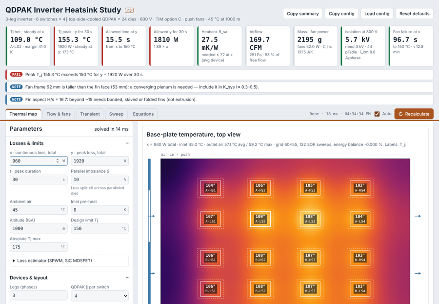
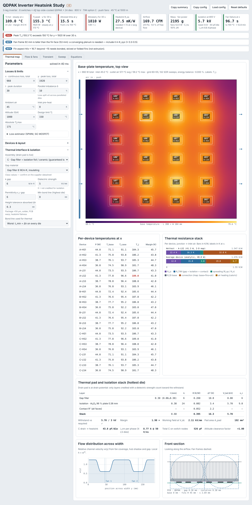

# HeatSincPro — QDPAK Inverter Heatsink Study

Interactive design study for the forced-air heatsink of a 3-phase, 800 V inverter built from
**6 switch positions × 4 paralleled top-side-cooled QDPAK (24 dies)**. It checks a continuous loss **x W**,
a peak **y W for t s**, isolation of the live drain pad, and fan failure.

**Run it:** open `dist/HeatsinkStudy_r3.html` in any browser. It is one self-contained file and works offline;
only the web fonts need a network connection, and system fonts are used without one.



## What it covers
| Area | Model |
|---|---|
| Air at altitude | ISA pressure, ideal-gas density, Sutherland μ and k |
| Fans | Δp = (ρ/ρ₀)s²Δp_max[1 − (Q/(n_p s Q_max))ⁿ]; push, pull, push-pull (series), impingement, natural |
| System | fin core + parallel bypass (tip/side clearance, equal Δp) + K_sys; operating point by bisection |
| Plate fins | Shah–London fRe, Muzychka–Yovanovich developing flow, Petukhov; Stephan (laminar) and Gnielinski (turbulent) heat transfer; Teertstra cross-check |
| Pin fins | Žukauskas heat transfer with row factor, Khan–Culham–Yovanovich friction |
| Heatsink | fin efficiency, η₀, NTU, R_sa = 1/(ṁc_pε) |
| Device stack | R_jc, insulation stack (A gap filler · B gap pad · C filler + foil/ceramic), Lee spreading |
| Thermal map | 2-D SOR base-plate conduction with air marching per channel strip and fan-coverage weights |
| Transient | datasheet Z_jc Foster + exact Cauer→Foster of the case-to-air ladder; pulse superposition; allowed time and allowed peak; fan failure to natural convection + radiation |
| Isolation / EMI | withstand vs requirement, working field, drain-to-heatsink C, common-mode current per phase, IEC 60664-1 altitude factor |

The **Equations** tab lists every equation with its current value. **Sweep** varies one parameter and plots T_j, R_sa, airflow and mass.



## Using it
- Change any value under **Setup / Parameters**. With **Auto** on, it recalculates about 0.1 s after each edit.
- Turn **Auto** off to change several values; results grey out until you press **↻ Recalculate** (or Enter / Ctrl+Enter).
- The progress bar shows the solver stage. **Copy config** / **Load config** save and restore a case as JSON.

## Repository layout
```
dist/   HeatsinkStudy_r1.html, _r2.html, _r3.html   built pages (one per revision)
src/    engine.js (physics), defaults.js, ui.js, template.html
docs/   HeatsinkStudy_Plan_r1…r3.md (progress, decisions, risks, next steps), img/
tests/  engine_check.js (Node), browser_test.py (Playwright)
build.py  assembles src/ → dist/HeatsinkStudy_<REV>.html
```
Tags `r1`, `r2` and `r3` mark each revision. Rebuilding a tag reproduces its page byte-for-byte.

## Build and test
```bash
python3 build.py                       # writes dist/HeatsinkStudy_r3.html
node tests/engine_check.js             # physics regression checks
pip install playwright && playwright install chromium
python3 tests/browser_test.py          # UI test; set CHROME=/path/to/chrome to use an installed Chrome
```

## Revisions
| Rev | Change |
|---|---|
| r1 | Interactive model, 12-device topology (later corrected) |
| r2 | 6 × 4∥ = 24 dies, four layouts; 800 V insulation stack per Infineon Q-DPAK guidance; isolation and EMI checks |
| r3 | Recalculate button, Auto toggle, solver progress bar; step-wise solver (results identical to r2) |

## Placeholders to replace
Default inputs are examples, not product data: R_jc 0.30 K/W and the Z_jc Foster terms, the 16 × 12 mm exposed pad,
fan curves (generic size classes), TIM and ceramic properties (class values), the 3 kV withstand requirement, and the losses.

## Known limitations
- Fan-coverage weights w(y) and the impingement factor are engineering estimates; calibrate with CFD or measurement.
- Axial-fan stall region is not modelled; a warning appears below 35 % of free-air flow.
- Laminar plate-fin models: Stephan and Teertstra agree within 2 % on the r1 geometry but differ by about 14 % on the 24-die default at low fan speed. The default operating point is turbulent (Gnielinski).
- Losses are inputs and are not coupled to R_ds,on(T_j); the bond line is applied as worst or mean to every die.
